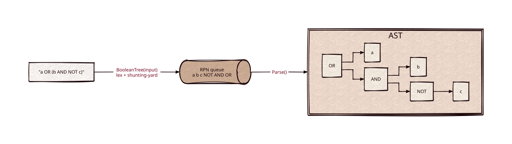

# boolean-parser

[](https://github.com/Kronuz/boolean-parser/actions/workflows/ci.yml)
[](LICENSE)


A boolean-expression parser for C++17: `a OR (b AND NOT c)` becomes a Reverse
Polish token queue you can walk, or an AST of typed nodes. For search-query
syntax, filters, and rule languages.



## ✨ Highlights

- **Five operators,** as words or symbols: `AND` (`&`), `OR` (`|`), `NOT` (`!`),
  `XOR`, and `MAYBE`, with precedence `NOT > AND > MAYBE > XOR > OR`.
- **Two outputs.** Walk the RPN queue directly, as Xapiand does, or call
  `Parse()` for an AST of `AndNode`, `OrNode`, `NotNode`, `XorNode`, `MaybeNode`,
  and `IdNode`.
- **Phrases and lists.** `"quoted phrases"` and `[a,b,c]` lists arrive as single
  terms; adjacent terms join with `OR`.
- **Clear errors.** Malformed input throws `LexicalException` or
  `SyntacticException` with a message, never undefined behavior.

## 📦 Installation

Requires a C++17 compiler and CMake 3.14 or newer. CI builds it on Linux (x86_64,
arm64), macOS (arm64, x86_64), and FreeBSD, plus ASan, UBSan, and TSan builds.

```cmake
include(FetchContent)
FetchContent_Declare(boolean_parser
  GIT_REPOSITORY https://github.com/Kronuz/boolean-parser.git
  GIT_TAG        main)
FetchContent_MakeAvailable(boolean_parser)

target_link_libraries(my_app PRIVATE boolean_parser::boolean_parser)
```

## 🚀 Quick start

```cpp
#include "BooleanParser.h"

#include <cstdio>

int main() {
	BooleanTree tree("a OR (b AND NOT c)");   // lexes and builds the RPN queue
	for (; !tree.empty(); tree.pop_front()) {
		const Token& t = tree.front();
		std::printf("%s ", t.get_type() == TokenType::Id ? t.get_lexeme().c_str() : "op");
	}
	// a b c op op op   (NOT, AND, OR)

	BooleanTree ast("a AND b");
	ast.Parse();                               // ast.root: AndNode(IdNode a, IdNode b)
}
```

[`examples/demo.cc`](examples/demo.cc) prints the RPN stream and the AST, drawn as
a tree, for a handful of expressions.

## 🎯 When to use it

- ✅ Parsing user-facing boolean query syntax into a structure you evaluate.
- ❌ Arithmetic, comparisons, or field syntax: it knows boolean operators and
  terms only.

## 📚 Documentation

- [docs/API.md](docs/API.md): `BooleanTree`, tokens, AST nodes, exceptions, and
  caveats.
- [ARCHITECTURE.md](ARCHITECTURE.md): the lexer, the shunting-yard, and the tree
  builder.
- [AGENTS.md](AGENTS.md): repository map, invariants, and traps.

## 🛠️ Building and testing

```sh
cmake -B build && cmake --build build && ctest --test-dir build
./build/boolean_parser_demo
```

## 🤝 Contributing

Issues and pull requests are welcome. Read [AGENTS.md](AGENTS.md) first. CI must
pass on every platform.

## 📄 License

MIT, Copyright (c) 2015-2019 Dubalu LLC. See [LICENSE](LICENSE). Extracted from
[Xapiand](https://github.com/Kronuz/Xapiand), where it parses query strings.
