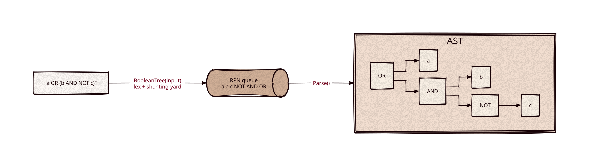

# boolean-parser

Part of [Kronuz C++ Libraries](https://github.com/Kronuz/cpp-libraries), a collection of small, reusable C++ libraries.

[](https://github.com/Kronuz/boolean-parser/actions/workflows/ci.yml)
[](LICENSE)


A boolean-expression parser for C++17: `a OR (b AND NOT c)` becomes a Reverse
Polish token queue you can walk, or an AST of typed nodes. For search-query
syntax, filters, and rule languages.



## ✨ Highlights

- **Five operators,** as words or symbols: `AND` (`&`), `OR` (`|`), `NOT` (`!`),
  `XOR`, and `MAYBE`, with precedence `NOT > AND > MAYBE > XOR > OR`.
- **Two outputs.** Walk the RPN queue directly, as Xapiand does, or call
  `Parse()` for an AST of `AndNode`, `OrNode`, `NotNode`, `XorNode`, `MaybeNode`,
  and `IdNode`.
- **Phrases and lists.** `"quoted phrases"` and `[a,b,c]` lists arrive as single
  terms; adjacent terms join with `OR`.
- **Clear errors.** Malformed input throws `LexicalException` or
  `SyntacticException` with a message, never undefined behavior. A queue the
  constructor returns is empty or one well-formed RPN expression: every operator
  has its operands and no parenthesis is left in it.

## 📦 Installation

Requires a C++17 compiler and CMake 3.14 or newer. CI builds it on Linux (x86_64,
arm64), macOS (arm64, x86_64), and FreeBSD, plus ASan, UBSan, and TSan builds.

```cmake
include(FetchContent)
FetchContent_Declare(boolean_parser
  GIT_REPOSITORY https://github.com/Kronuz/boolean-parser.git
  GIT_TAG        main)
FetchContent_MakeAvailable(boolean_parser)

target_link_libraries(my_app PRIVATE boolean_parser::boolean_parser)
```

## 🚀 Quick start

```cpp
#include "BooleanParser.h"

#include <cstdio>

int main() {
	BooleanTree tree("a OR (b AND NOT c)");   // lexes and builds the RPN queue
	for (; !tree.empty(); tree.pop_front()) {
		const Token& t = tree.front();
		std::printf("%s ", t.get_type() == TokenType::Id ? t.get_lexeme().c_str() : "op");
	}
	// a b c op op op   (NOT, AND, OR)

	BooleanTree ast("a AND b");
	ast.Parse();                               // ast.root: AndNode(IdNode a, IdNode b)
}
```

[`examples/demo.cc`](examples/demo.cc) prints the RPN stream and the AST, drawn as
a tree, for a handful of expressions.

## 🧮 Grammar and precedence

`NOT` binds tightest, then `AND`, `MAYBE`, `XOR`, and `OR` loosest. Every binary
operator is left associative, and parentheses group. Two operands with no operator
between them (a term, a `)`, then a term, `(` or `NOT`) are joined by an implicit `OR`,
which has the loosest precedence like an explicit one:

| input | parses as |
|---|---|
| `a & b c` | `(a AND b) OR c` |
| `x AND a b` | `(x AND a) OR b` |
| `NOT a b` | `(NOT a) OR b` |
| `a b & c` | `a OR (b AND c)` |
| `a b NOT c` | `(a OR b) OR (NOT c)` |
| `a & b & c` | `(a AND b) AND c` |

`test/oracle.cc` checks this grammar against an independent recursive-descent parser
on every token sequence over a small vocabulary up to length 7 (8 and 9 with `BP_MAX_LEN`)
and on random longer ones. `test/fuzz.cc` is a libFuzzer target that checks the same
parser, and the well-formedness of the queue, on mutated inputs.

## 🚫 Errors

The constructor lexes and builds the queue, so malformed input throws there:

| input | exception |
|---|---|
| `"unterminated`, `[a` | `LexicalException` |
| `a )`, `a AND b )` | `SyntacticException`: `) was expected` |
| `(a`, `a (`, `a AND (b` | `SyntacticException`: `'(' not expected` |
| `a NOT`, `a AND`, `AND a`, `a ()`, `( ) a` | `SyntacticException`: `Unexpected end of expression` |

Input with no operand at all (blank, or only empty groups such as `()`) gives an empty
queue; `Parse()` throws on it.

## 🎯 When to use it

- ✅ Parsing user-facing boolean query syntax into a structure you evaluate.
- ❌ Arithmetic, comparisons, or field syntax: it knows boolean operators and
  terms only.

## 📚 Documentation

- [docs/API.md](docs/API.md): `BooleanTree`, tokens, AST nodes, exceptions, and
  caveats.
- [ARCHITECTURE.md](ARCHITECTURE.md): the lexer, the shunting-yard, and the tree
  builder.
- [AGENTS.md](AGENTS.md): repository map, invariants, and traps.
- [CHANGELOG.md](CHANGELOG.md): what changed, and when.

## ⚡ Performance

The lexer scans the input by pointer and builds each lexeme with one allocation
(none up to the small-string size). Tokens move through the shunting-yard. The
token queue, the operator stack and the input copy live inside the `BooleanTree`
for an ordinary query (16 tokens, 8 operators, 128 bytes), so they allocate
nothing. The nodes come from a per-thread cache of freed blocks behind
`BaseNode`'s `operator new`, so a second parse on a thread reuses the first one's
blocks (up to 256 per 16-byte size class).

`bench/bench_bool.cc` times a full parse (`BooleanTree`: lex, shunting-yard, and
`Parse()`) against a precedence-climbing parser with an arena and `string_view`
lexemes. That parser builds no heap nodes, so it is a floor. Apple M4 Pro, Apple clang
17 with `-O3 -DNDEBUG`, ns per parse (median of three interleaved runs of the benchmark,
each the median of about 40 ms trials), measured under `quiet strict`. "Before" is
`e099477`, the parser without the allocation changes:

| Input | Before | Now | Precedence climbing |
|---|---:|---:|---:|
| `alpha AND beta` | 156 ns | 80 ns | 56 ns |
| 5 terms, mixed operators | 315 ns | 196 ns | 119 ns |
| A typical field query | 342 ns | 218 ns | 133 ns |
| 16 random terms | 1.36 µs | 1.04 µs | 0.49 µs |
| 128 random terms | 10.8 µs | 8.35 µs | 4.01 µs |
| 1,024 random terms | 104 µs | 104 µs | 33.7 µs |
| 200 nested parentheses | 2.59 µs | 2.53 µs | 2.94 µs |

On an Intel i9-9980HK (Apple clang 17, same flags) the same rows read 464, 942, 955 ns,
3.74, 30.0 and 256 µs before, and 146, 395, 401 ns, 2.04, 17.6 and 252 µs now, against
160, 273, 220 ns, 0.85, 7.09 and 56.6 µs for the precedence climber (200 nested
parentheses: 6.15 µs before, 5.29 µs now, 4.65 µs).

```sh
cmake -B build -DBOOLEAN_PARSER_BENCH=ON -DCMAKE_BUILD_TYPE=Release
cmake --build build && ./build/boolean_parser_bench
```

The precedence climber is 1.4 to 1.7 times faster on short queries, about 2.1 times
on 16 to 128 terms and 3.1 times on 1,024, where the node cache (256 blocks per
size class) is too small for the tree. It builds no nodes, while `BooleanTree` builds
one virtual node per term and operator behind `unique_ptr`; closing the rest of the
gap needs an arena owner type in the node API. `BooleanTree` is faster on deeply nested
input.

## 🛠️ Building and testing

```sh
cmake -B build && cmake --build build && ctest --test-dir build
./build/boolean_parser_demo
```

## 🤝 Contributing

Issues and pull requests are welcome. Read [AGENTS.md](AGENTS.md) first. CI must
pass on every platform.

## 📄 License

MIT, Copyright (c) 2015-2019 Dubalu LLC. See [LICENSE](LICENSE). Extracted from
[Xapiand](https://github.com/Kronuz/Xapiand), where it parses query strings.
